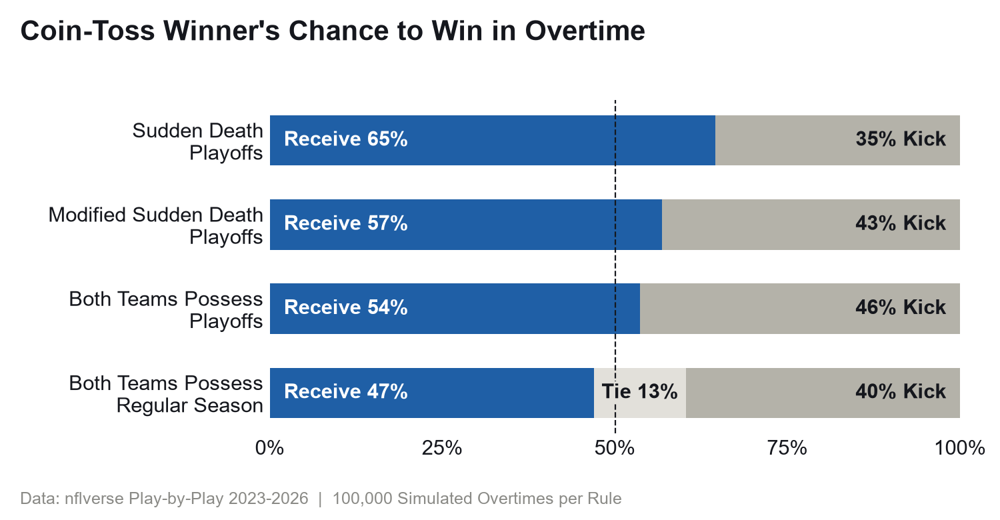
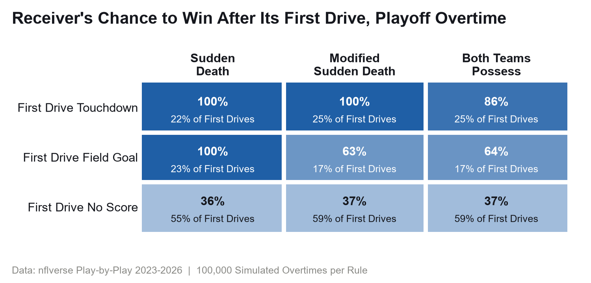
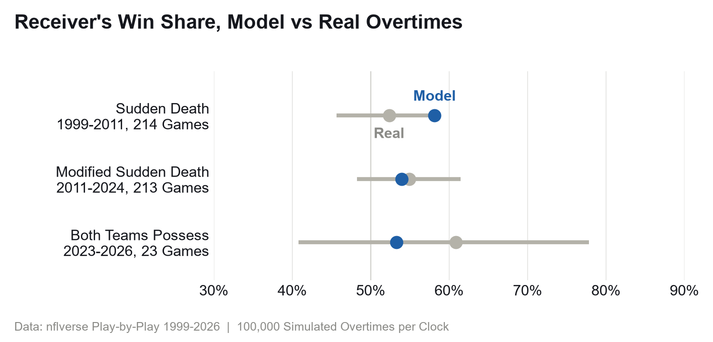

# NFL Overtime: Kick or Receive?

**A snap-by-snap simulation of NFL overtime, built from 1,201,470 plays (1999 through week 5 of
2026), that plays 100,000 overtimes under each rule the league has used. Under today's rule,
where both teams get the ball, the coin-toss winner should still take it: receiving wins 53.6%
of playoff overtimes, and 46.9% of regular-season ones against 39.7% for kicking (13.4% tie).
The old sudden death rule, played on today's game, gave the receiver 64.5%.**



## The Question

In Super Bowl LVIII the 49ers won the overtime coin toss, took the ball and kicked a field goal.
The Chiefs got the ball knowing exactly what they needed and scored a touchdown to win. It had
everyone asking whether you should kick now, so you're the team that knows what it needs.

Win rates can't settle that. There have only been 23 overtimes under the new rule. So I built
overtime up from single snaps and played it out under each rule set.

## The Data

Play-by-play from [nflverse](https://github.com/nflverse/nflverse-data), 1999 to week 5 of 2026,
and the [nfldata](https://github.com/nflverse/nfldata) schedule for scores: 450 overtime games.

- **The schedule's overtime flag misses games** (`2021_12_LV_DAL` is one), so an overtime is any
  game with an overtime kickoff in the play-by-play.
- **On a kickoff, `posteam` is the receiving team,** so the receiver is the `posteam` of the first
  overtime kickoff.
- **Timeout rows have no team** and break the chain from one snap to the next, so they're dropped.
- **Penalties count.** A snap's yards come from where the next snap is spotted, and a penalty
  short of the line to gain repeats the down instead of using one up.
- **The rule changed twice.** Sudden death until 2011 (2009 in the playoffs), then a
  first-possession field goal no longer ended it, then both teams get the ball (playoffs from
  2022, regular season from 2025). In the data, first-drive touchdowns stop ending games in 2025.
- **2026 is still being played,** so the build cuts any later download back to week 5.

## The Method

```
snap      resample a real snap with the same down, distance band and field position band
4th down  go, punt or kick the way teams do in regulation, unless the score decides it
drive     snaps until a score, a turnover, a punt or the clock runs out
overtime  drives under one rule set's scoring and possession rules, 100,000 times
```

- **Snaps come from close regulation games** (within 8, outside the last two minutes of a half),
  never overtime, so real overtimes stay a fair check.
- **A 4th-down try resamples a 3rd-down snap,** since real tries are too rare to fill every
  bucket.
- **The score makes some calls.** A last-chance drive never punts, kicks when a field goal ties or
  wins at a 50% make chance or better, and goes for it when it needs a touchdown. In the last two
  minutes of a timed overtime snaps come as fast as real two-minute drills, and with 20 seconds
  left a team that a field goal wins or ties for kicks on any down.
- **Kicks:** a logistic fit on distance (a 50-yarder is 75.2% today), extra points 95.6%, two-point
  tries 48.3%. Kickoffs and punts resample real ones. A kickoff or punt the kicking team recovers
  counts as the other team's possession (Rule 16-1-5(c)).
- **Today's game** is 71,160 snaps from 2023-2026 and 3,517 kickoffs from 2025-26 (the receiver
  starts at its own 30.1 on average), with equal teams. All three rules are played on it.

I checked drives first. Fit on 2021-2024 and run from the start of 3,134 close 2025 drives, the
model scores touchdowns on 25.5% and field goals on 16.7%. The real drives: 25.6% and 17.4%.

## The Finding

**Receiving is right under every rule, but the edge has shrunk.** Played on today's game, the
receiver wins 64.5% of playoff overtimes under sudden death, 56.8% under modified sudden death and
53.6% when both teams possess.

**A first-drive score is worth less than it was.** Under sudden death any score wins. Under
modified sudden death a first-drive field goal (16.7% of first drives) wins only 62.7% of the
time, and under today's rule even a touchdown wins 86.5%. After a scoreless first drive the
receiver wins 35.6% to 37.1% under every rule.



**Going for two helps the kicking team a little.** If the second team goes for two when a
touchdown leaves it down 1, kicking wins 47.7% of playoff overtimes instead of 46.4%.

**The regular season adds ties, not a different answer.** In a 10-minute overtime under today's
rule, receiving wins 46.9%, kicking 39.7%, and 13.4% end tied.

**The model matches real overtimes where there are enough of them.** Counting a tie as half a win,
receivers won 54.9% of 213 modified sudden death overtimes (95% interval 48.2% to 61.5%); the model
says 53.9%. Under sudden death they won 52.3% (45.7% to 58.9%) against the model's 58.1%, inside
the interval but near the top. The 23 games under today's rule (60.9%, 40.8% to 77.8%) are too few
to say anything.



## Caveats

- **Equal teams.** No team strength, no weather, no particular kicker.
- **Too many ties.** Across the 422 real timed overtimes, the model expects 24 ties; there were 16.
- **Play-calling is regulation play-calling.** The score changes 4th downs and kicks, not 1st to
  3rd down, so simulated sudden death teams chase touchdowns where real ones take the field goal.
- **Teams kick the extra point** except in the one go-for-two run.

## Run It

```bash
python -m venv .venv
source .venv/Scripts/activate   # Windows; source .venv/bin/activate on Mac or Linux
pip install -e ".[dev]"

python scripts/pull.py          # nflverse downloads, skips files you already have
python scripts/build.py         # about 5 seconds
python scripts/model.py         # every simulation, about 1 minute
python scripts/readme_numbers.py
python scripts/figures.py
pytest -q
ruff check .
```

## Layout

- `src/overtime/data.py` raw files to one play table and one overtime game table
- `src/overtime/sim.py` the snap model, drives and the three rule sets
- `scripts/` pull, build, model, README numbers, figures
- `results/` every number above in small CSVs; `readme_numbers.csv` has the exact values quoted
- `figures/` the three charts
- `tests/test_sim.py` rule logic with scripted drives, drive mechanics, the logistic fit
- `tests/test_data.py` a synthetic play table through the next-play chain, the fit and the
  overtime game list
- `tests/test_figures.py` the capitals check

## Credits

What's committed is the code, the small result CSVs in
`results/` and the charts in `figures/`; no raw or derived data is.

- **Play-by-play:** [nflverse-data](https://github.com/nflverse/nflverse-data), released under
  [CC BY 4.0](https://creativecommons.org/licenses/by/4.0/). The results and charts here are built
  from it, with attribution to nflverse.
- **Schedule:** Lee Sharpe's [nfldata](https://github.com/nflverse/nfldata), which has no licence
  file, so `games.csv` isn't redistributed here; `scripts/pull.py` downloads it from the source.

## References

- Sebastian Carl and Ben Baldwin, [nflfastR](https://www.nflfastr.com/), the play-by-play behind nflverse
- Ben Baldwin, [nfl4th](https://www.nfl4th.com/), for treating a 4th-down try like a 3rd-down play
- David Romer (2006), [Do Firms Maximize? Evidence from Professional Football](https://doi.org/10.1086/501171), *Journal of Political Economy*
- NFL Football Operations, [2026 NFL Rulebook](https://operations.nfl.com/rules-officiating/2026-nfl-rulebook), Rule 16 (overtime)
