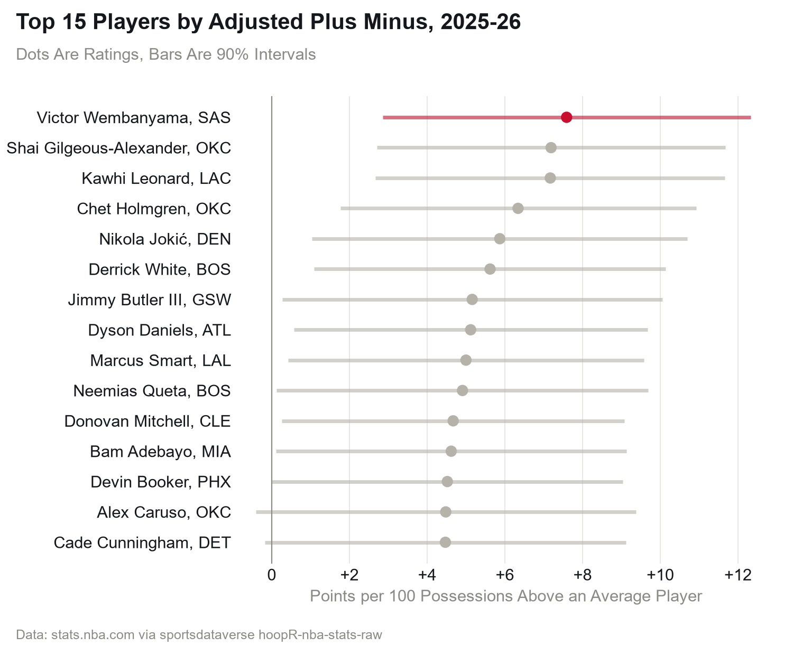
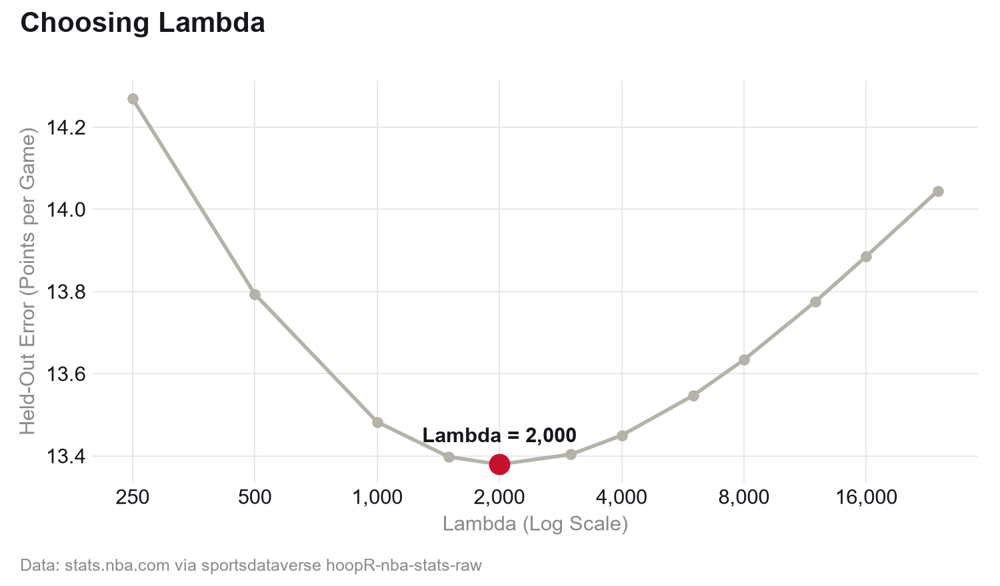
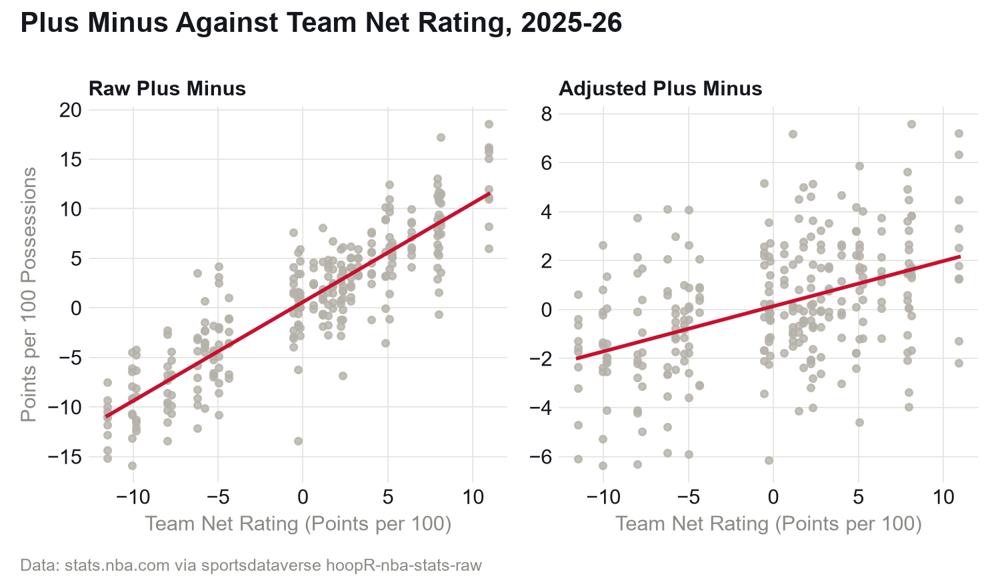
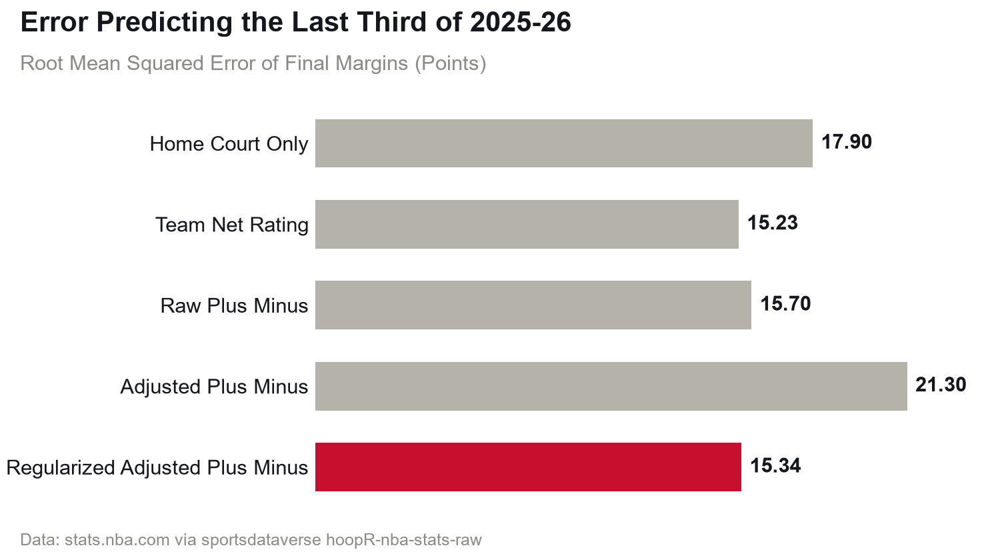

# Exploring NBA Regularized Adjusted Plus Minus

**Regularized adjusted plus-minus for every player in the 2025-26 NBA regular season, built
from the play-by-play of all 1,230 games. Victor Wembanyama comes out on top at +7.6 points per
100 possessions better than an average player, but he is first in only 48 of 200 resampled
seasons. How good a player's team was explains 77% of the differences in raw plus-minus, and
only 19% of the adjusted version.**

Inspired by Maddy's [What is a steal actually worth?](https://github.com/madbro206/wnba-analysis/tree/main/team-ridge-regression),
which ends on the caveat that plus-minus is mostly about who you play with.



## The Question

OKC outscored opponents by 8.2 points per 100 possessions with Luguentz Dort on the floor in
2025-26, 35th best of the 279 players with 1,000 minutes. Utah was outscored by 2.3 with Lauri
Markkanen on the floor, 189th. Nobody thinks Dort is the better player. His team was +10.9 per
100 overall, and Markkanen's was -8.0.

So how much of plus-minus is the player, and with teammates and opponents taken out, who is
at the top?

## The Data

stats.nba.com JSON as archived in the sportsdataverse
[hoopR-nba-stats-raw](https://github.com/sportsdataverse/hoopR-nba-stats-raw) release
`nba-stats-raw-json`, play-by-play and box scores for every regular season game. The ratings use
2025-26 (1,230 games, 39,823 stints, 582 players), and choosing the penalty uses the 11 seasons
before it, 13,197 games.

A stint is a stretch with the same ten players on the floor. Rebuilding them was the work:

- Substitutions name the incoming player only as text: "Doncic" for Dončić, "Se. Curry" and
  "St. Curry", "Hansen" for Yang Hansen. I match it against that game's roster.
- Nobody records who starts the 2nd to 4th quarters, and the per-period box scores are empty. A
  player who does something, or gets subbed out, before being subbed in started the quarter.
- Before 2017-18 the score reads 0-0 on every play that isn't a basket.

Some games have official rotation data. Over those 2,047 hours my ten players match it exactly
99.5% of the time (98.6% in the worst season). I dropped 12 games whose scoring doesn't add up
to the box score. Possessions are FGA - offensive rebounds + turnovers + 0.44 × FTA, averaged
over the two teams.

## The Method

```
margin per 100 possessions = home court + (sum of home five) - (sum of away five) + noise
```

This is Maddy's [margin Bradley-Terry model](https://github.com/madbro206/wnba-analysis/tree/main/bradley-terry-playoff-sim)
with ten players in each row instead of two teams, every stint weighted by its possessions.
Each player gets one net number, with no offense/defense split, because the question is
plus-minus.

- **Ridge, not plain least squares,** because teammates are heavily correlated and least squares
  gives wild ratings.
- **Lambda, the penalty, comes from held-out games.** For each season from 2014-15 to 2024-25 I
  fit the first two thirds of games by date and predict every final margin in the last third
  (4,431 games) from who actually played. Lambda = 2,000 does best, and anything from 1,500 to
  3,000 is within 0.05 points.
- **One held-out test** on 2025-26 (411 games) against home court only, team net rating, raw
  plus-minus (averaged over the five) and plain least squares.
- **The final ratings** use all 1,230 games, shown so 0 is the minutes-weighted average player.
  The 90% intervals treat the penalty as a starting belief that every player is average;
  resampling the games 200 times answers only who comes out first.



## The Finding

**Raw plus-minus is mostly the team.** Among players with 1,000 minutes, team net rating
explains 77% of the differences in raw plus-minus and 19% in the adjusted ratings. Dort goes from
35th to 234th, Markkanen from 189th to 22nd, and the league's best raw plus-minus, Alex Caruso's
+18.6, is 14th once adjusted.



**Wembanyama is on top, but not by much.** He is +7.6 (interval +2.9 to +12.3), with Shai
Gilgeous-Alexander and Kawhi Leonard both at +7.2. Across 200 resampled seasons he is first 48
times, Leonard 41 and Gilgeous-Alexander 34. The typical interval is 9.2 points wide.

**Adjusted plus-minus predicts the rest of 2025-26 no better than team net rating,** 15.34 points
a game against 15.23 (z = 0.5; between -2 and 2 is no real difference, below -2 is clearly
better), even though it knows who actually played. It beats raw plus-minus (15.70, z = -2.6),
and without the penalty misses by 21.30, worse than home court alone (17.90). Over the 11 earlier
seasons it beat team net rating 13.38 to 13.54 (z = -2.7).



## Caveats

- **One season is noisy.** Only big gaps mean much.
- **Last season doesn't break the tie.** Adding 2024-25's games (15.17, z = -0.3) or shrinking
  toward 2024-25 ratings instead of average (15.07, z = -0.7) still only ties team net rating.
- **Shrinkage splits credit by assumption** between players who always share the floor.
- **Every possession counts the same,** garbage time and tanking included, and free throws
  after a substitution count for the new five.

## Run It

```sh
python -m venv .venv
source .venv/bin/activate          # Windows: .venv\Scripts\activate
python -m pip install -e ".[dev]"
python scripts/pull.py             # 1.2 GB of bundles, skips any already in data/raw/bundles
python scripts/build.py            # stints for 12 seasons
python scripts/model.py            # lambda, the test, final ratings
python scripts/readme_numbers.py   # every number above, into results/numbers.csv
python scripts/figures.py
python -m pytest -q && python -m ruff check .
```

Times on a Windows laptop with the bundles already downloaded: install 23 s, build 66 s, model
36 s, numbers 4 s, figures 2 s, tests 4 s. The full pull is 1.2 GB.

## Layout

```
src/nbapm/stints.py    one game's play-by-play to stints
src/nbapm/rapm.py      the model, raw plus-minus and the error measures
scripts/               pull, build, model, readme_numbers, figures
results/               data_checks, lambda_tuning, model_test, last_season_test,
                       ratings_2025_26, numbers (CSV)
figures/               the four charts
tests/                 parsing and model checks
data/raw/bundles/      downloaded bundles (not committed)
artifacts/             built stints (not committed)
```

## Credits

The play-by-play and box scores are NBA.com's
statistics, used under NBA.com's terms of use, as archived in the sportsdataverse
hoopR-nba-stats-raw release, which its authors license
[CC BY 4.0](https://creativecommons.org/licenses/by/4.0/) (see its `LICENSE.md`); every chart
credits the source. ESPN odds and scoreboards sit in `data/raw/espn/` from earlier work; nothing
here uses them, and they stay under ESPN's terms of use.

Committed: the code, tests, CI, and the derived `results/` (small CSVs) and `figures/`, rebuilt
from the bundles into stints and ratings by the scripts above. Not committed: everything in
`data/raw/`, which `scripts/pull.py` downloads again (bundles only), and the stints in
`artifacts/`.

## References

- Dan T. Rosenbaum (2004), [Measuring How NBA Players Help Their Teams Win](http://www.82games.com/comm30.htm), 82games.com
- Joseph Sill (2010), *Improved NBA Adjusted +/- Using Regularization and Out-of-Sample Testing*, MIT Sloan Sports Analytics Conference
- Dean Oliver (2004), *Basketball on Paper*, Potomac Books (the possession estimate)
- Maddy, [wnba-analysis](https://github.com/madbro206/wnba-analysis): team-ridge-regression and bradley-terry-playoff-sim
