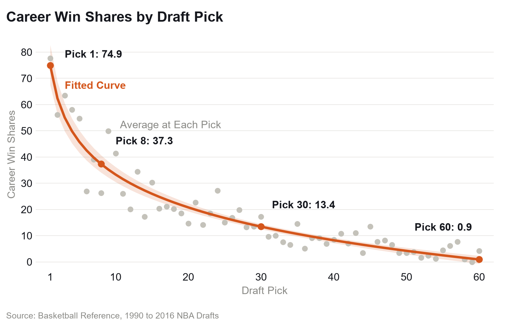
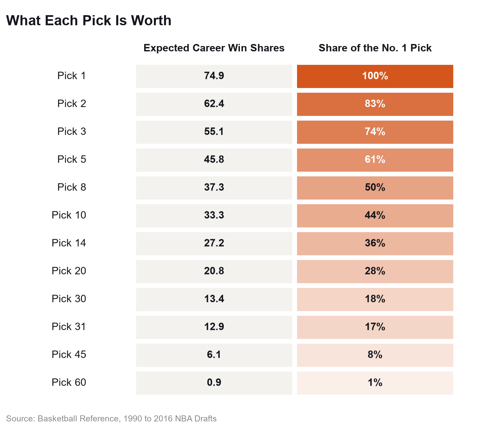
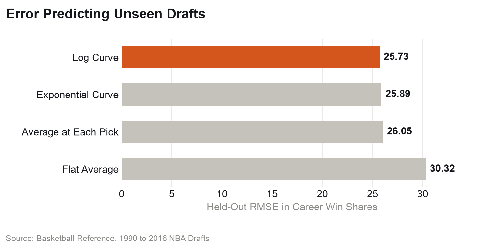

# NBA Draft Pick Value Curve

**A curve of what each NBA draft pick is worth, fit to the career Win Shares of all 1,568
players drafted from 1990 to 2016. The No. 1 pick is worth 74.9 career Win Shares, the value is
cut in half by pick 8, and every time the pick number doubles, the pick loses about 12.5 Win
Shares.**



## The Question

In June 2017 the Celtics traded the No. 1 pick to the 76ers for No. 3 and a future first.
Philadelphia took Markelle Fultz, Boston took Jayson Tatum, and the future first became the 14th
pick in 2019 (Basketball Reference's [2017](https://www.basketball-reference.com/draft/NBA_2017.html)
and [2019](https://www.basketball-reference.com/draft/NBA_2019.html) draft pages). It's
remembered for how those careers went, but it was made on draft night, so the fair question is
what the picks were worth then.

So how much is No. 1 worth, how fast does that fall off, and is a second round pick worth
anything at all?

## The Data

Basketball Reference's draft pages for 1990 to 2016, pulled on October 15, 2026, so careers
count through the 2025-26 season: 1,568 players across 27 drafts. I stop at 2016 so every class
has had at least 10 seasons.

A pick's value is the career Win Shares of the player taken there, Basketball Reference's
estimate of the wins a player added.

Three traps. 228 draftees never played an NBA game and their stats come through blank; dropping
them would flatter the late picks, so they count as 0 Win Shares. The drafts aren't all the same
size: 54 picks a year through 1994, up to 60 from 2005, and no pick 29 in 1997, 2001 or 2002. And
the round isn't the pick number (1990 had only 27 first round picks), so the round comes from the
page's own "Round 2" header row.

## The Method

```
Win Shares = a - b × ln(pick)
```

fit with ordinary least squares on all 1,568 draftees: a = 74.9 and b = 18.07.

- **The log of the pick, because the gap between picks 1 and 2 is not the gap between 51 and
  52.** Every doubling of the pick number costs the same b × ln 2 Win Shares.
- **A curve, not the raw average at each pick.** Each pick has only 27 drafts behind it and one
  star moves its average a lot: the 6th pick averages 26.9 Win Shares, the 9th 49.9.
- **Tested on drafts it hadn't seen.** I left out one draft at a time, fit on the other 26 and
  scored the missing one (root mean squared error), against a flat average, the raw average at
  each pick, and an exponential curve.
- **Uncertainty from resampling whole drafts.** 2,000 bootstrap resamples give the 90% band and
  the intervals below.

## The Finding

**The No. 1 pick is worth 74.9 career Win Shares** (90% interval 67.4 to 82.7). No. 2 is worth
62.4, No. 10 33.3, No. 30 13.4, and the curve is down to 0.9 by pick 60.

**Value is cut in half by pick 8, and every doubling of the pick costs about 12.5 Win Shares**
(90% interval 11.1 to 14.0). Picks 1, 2, 4, 8, 16 and 32 are each about 12.5 apart, and on paper
the No. 1 pick is worth two No. 8 picks.



Pricing the 2017 trade takes one piece of hindsight, counting the future first as the No. 14
pick it became. Priced that way it went Boston's way: 82.3 Win Shares for picks 3 and 14, against
74.9 for No. 1.

**The second round is worth little.** Second round picks averaged 6.9 career Win Shares against
30.4 in the first round, the median second rounder finished with 0.1, and 28% never played an NBA
game, against 0.8% of first rounders.

**On drafts it hadn't seen, the curve ties the raw averages and the exponential curve, and easily
beats one flat average.** Its held-out error is 25.73 Win Shares, against 25.89 for the
exponential curve (z = 1.4), 26.05 for the raw averages (z = 1.9) and 30.32 for the flat average
(z = 7.0). I keep the log curve because it smooths out one-star picks.



## Caveats

- **Recent careers aren't finished.** Fit on the 1990 to 2005 drafts alone, the No. 1 pick is
  worth 83.8 and value halves by pick 7.5; on 2006 to 2016 it's 62.3 and pick 8.8. The level
  moves, the shape mostly doesn't.
- **"Two No. 8s" assumes value adds up.** Two No. 8s take two roster spots where a star takes
  one, and career Win Shares include the years after the rookie contract, at market salary.
  Massey and Thaler priced NFL picks by value over salary instead and found teams pay too much
  to move up.
- **Averages here are carried by stars.** The 15th pick averages 30.3 Win Shares but the typical
  one finished with 10.6, thanks to Steve Nash (129.7), Giannis Antetokounmpo (125.8) and Kawhi
  Leonard (111.9).
- **Win Shares is one way to count value.** VORP gives a slightly steeper curve that halves by
  pick 6.9.

## Run It

```bash
python -m venv .venv
.venv\Scripts\activate             # macOS or Linux: source .venv/bin/activate
pip install -e ".[dev]"

python scripts/pull.py             # the 27 draft pages, about 3 minutes
python scripts/build.py            # data/draftees.csv, 3 seconds
python scripts/model.py            # results/fit.csv, curve.csv, model_test.csv, 4 seconds
python scripts/readme_numbers.py   # results/numbers.csv, every number in this README, 2 seconds
python scripts/figures.py          # figures/*.png, 4 seconds
pytest
ruff check .
```

`data/draftees.csv` is committed so the results reproduce: it is the October 15, 2026 snapshot,
and you can start at `model.py`. Re-pulling gets the pages as they are that day, and careers
still running move the numbers slightly (Jaylen Brown, at 47.5 Win Shares in the snapshot, has
played since). The pull step skips pages already in `data/raw/` and waits 4 seconds between
requests, inside Basketball Reference's limit of 20 a minute.

## Layout

```
src/draft_value/data.py     read a draft page into one row per draftee, with its round
src/draft_value/curve.py    the log curve, the models it is tested against, the bootstrap
src/draft_value/charts.py   the capitals check every chart has to pass
scripts/                    pull, build, model, readme_numbers, figures
data/draftees.csv           1,568 draftees, 1990 to 2016
results/                    the fit, the curve, the held-out test, every README number
figures/                    the three charts
tests/                      parsing, curve and chart tests
```

## References

- Basketball Reference, [NBA Draft](https://www.basketball-reference.com/draft/) pages and
  [Calculating Win Shares](https://www.basketball-reference.com/about/ws.html)
- Cade Massey and Richard Thaler (2013), [The Loser's Curse: Decision Making and Market
  Efficiency in the National Football League Draft](https://doi.org/10.1287/mnsc.1120.1657),
  *Management Science*
- Bradley Efron and Robert Tibshirani (1993), *An Introduction to the Bootstrap*, Chapman & Hall

## Credits

The draft data comes from Basketball Reference and is
used under Sports Reference's [terms of use](https://www.sports-reference.com/termsofuse.html).
`data/draftees.csv` is a small derived table, committed so the results reproduce. The raw pages
are not redistributed; `scripts/pull.py` re-fetches them.
