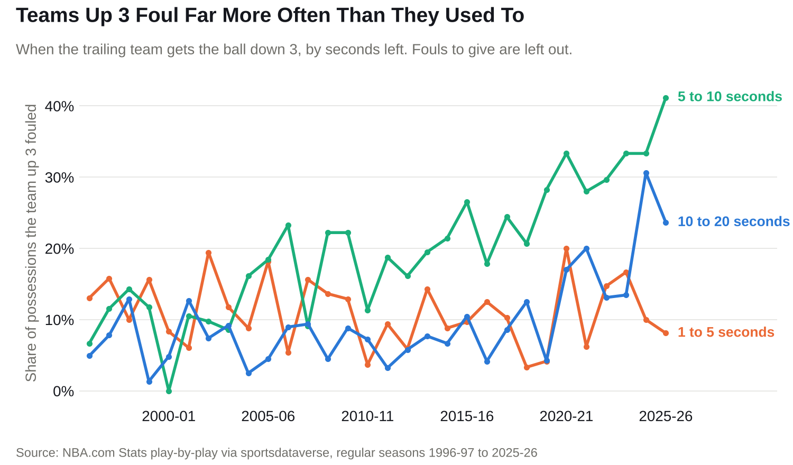
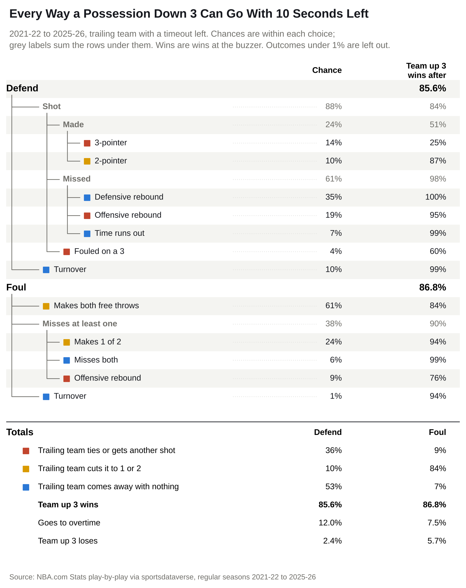
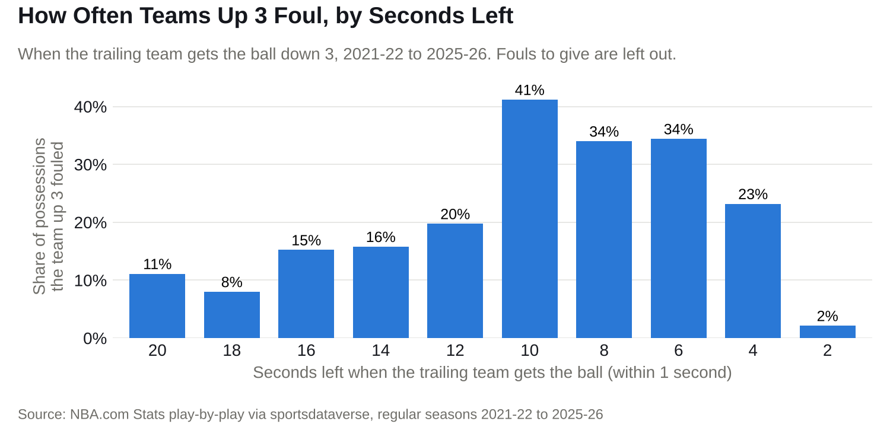
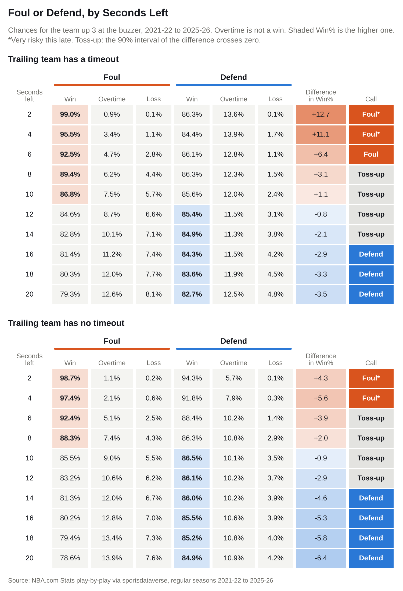

# NBA Fouling Up 3

Teams up 3 in the final seconds foul far more often than they used to. Should they, and when?



Teams up 3 fouled on 7% of these possessions in 1996-97 and 26% in 2025-26. Most of the rise came
with 5 to 10 seconds left: from 11% of possessions in 1996-97 to 2005-06 to 30% in 2016-17 to
2025-26.

Raw win rates can't settle whether it works, because teams choose when to foul. In an [ESPN
study](https://www.espn.com/nba/story/_/id/48582233/nba-playoffs-2026-foul-3-san-antonio-spurs-portland-trail-blazers-impact)
of the last five seasons, teams up 3 with 3 to 17 seconds left won 92.0% of the time when they
fouled and 91.7% when they defended. So this project builds the end of the game one possession at a
time.

## Method

- Data: the 6,150 regular-season games from 2021-22 to 2025-26, the five seasons since fouling
  jumped on the chart above, from NBA.com play-by-play.
- Every possession that starts with 24 seconds or less left in the 4th quarter or overtime counts.
  An offensive rebound starts a new one.
- Fouling means fouling before a shot and sending the trailing team to the line. Fouls to give don't
  count.
- For each score and second, the model uses what happened on possessions with the same score that
  started near that second. The window is 75% of the time left, the width that best predicted
  held-out seasons.
- It then works back from the buzzer, a tenth of a second at a time, to get each choice's chances to
  win, go to overtime and lose. Overtime is not a win.
- Down 3, the trailing team's outcomes come only from possessions where it had a timeout left, or
  only from ones where it had none. Timeouts are counted under the rules since 2017-18.
- Whenever the team up 3 is up 3 again later in the game, the model has it take the choice with the
  better Win%, and the trailing team's timeout state stays the same.
- The 90% intervals come from a bootstrap: 200 rebuilds of the model, each on the games resampled
  with replacement. A choice is clearly better when the whole interval is on one side of zero.
- Results stop at 20 seconds, past which there are too few fouls to estimate each second.
- Fit without 2024-25 and 2025-26, the model predicted who won at the buzzer on the 1,392 close-game
  possessions in those seasons about as well as the win rate for the same score and clock.

## Results

This is every way the trailing team's possession can go at 10 seconds, where teams foul most, when
it has a timeout left:





Fouling gains more when the trailing team has a timeout left: at 2 seconds, +12.7 points, against
+4.4 when it has none.

- Trailing team has a timeout: foul with 2 to 6 seconds left, defend from 15 seconds on.
- Trailing team has no timeout: foul with 2 to 5 seconds left, defend from 14 seconds on.
- In between, neither is clearly better.



## Checking the model

Wins at the buzzer against the model's expected wins, for every possession in 2021-22 to 2025-26
where the team up 3 fouled or defended:

| Choice | Seconds left | Games | Won | Model expected | Difference | p-value |
| ------ | ------------ | ----: | --: | -------------: | ---------: | ------: |
| Foul   | 1 to 5       |    18 |  17 |           17.4 |       -0.4 |    1.00 |
| Foul   | 5 to 10      |    80 |  71 |           72.0 |       -1.0 |    0.71 |
| Foul   | 10 to 20     |    56 |  50 |           47.0 |       +3.0 |    0.36 |
| Defend | 1 to 5       |   145 | 132 |          130.7 |       +1.3 |    0.78 |
| Defend | 5 to 10      |   162 | 136 |          140.0 |       -4.0 |    0.36 |
| Defend | 10 to 20     |   226 | 188 |          191.6 |       -3.6 |    0.52 |

## Limits

- The foul side is built only from fouls teams chose to make. If they foul in easier spots, an
  average foul would do worse.
- Every team is treated as average. The model doesn't know who is on the floor, or the team up 3's
  timeouts.

## Run it

```bash
pip install -e ".[dev]"
python scripts/pull.py       # will take a long time
python scripts/build.py      # will take a long time
python scripts/analyze.py    # will take a long time
python scripts/figures.py
python scripts/readme.py
pytest && ruff check .
```

## Credits

NBA.com Stats play-by-play and game logs, used under NBA.com's terms of use and read from the
sportsdataverse [hoopR-nba-stats-raw](https://github.com/sportsdataverse/hoopR-nba-stats-raw)
archive (CC BY 4.0). No raw data is committed; `scripts/pull.py` downloads it.
