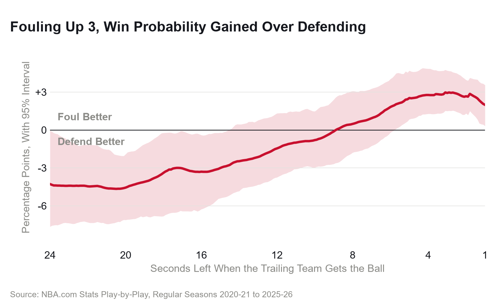
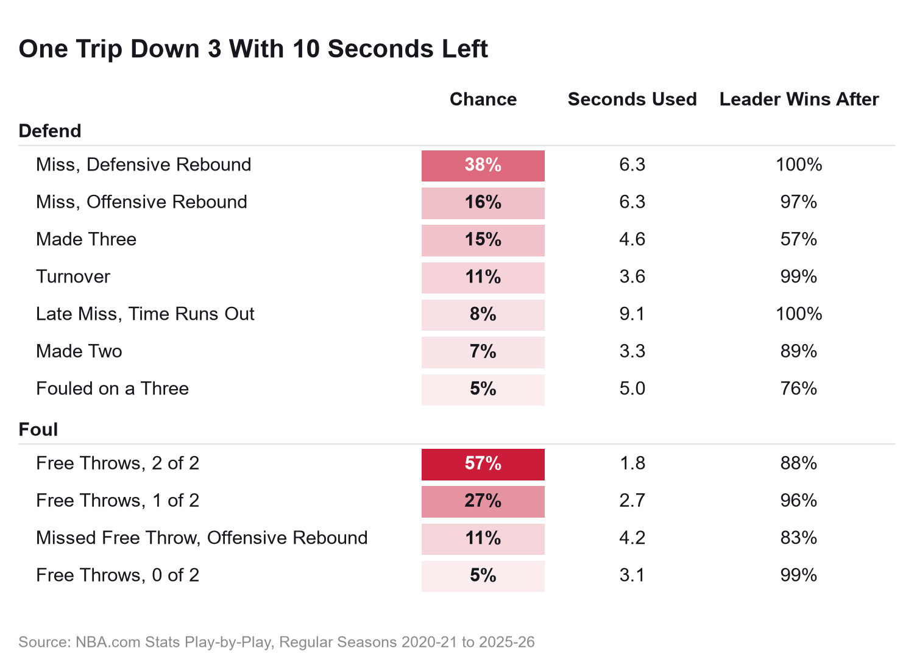
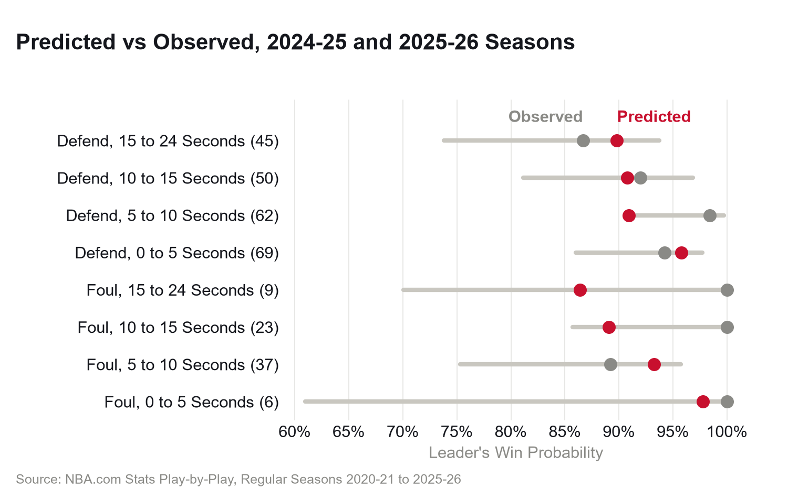

# NBA Fouling Up 3

**A play-by-play model of the last 24 seconds of NBA games, 2020-21 to 2025-26. When a team up 3
hands the other team the ball, fouling is the better choice with 5 seconds or less left and
defending is the better choice with 15 or more. With 2 seconds left, the leader wins 98.8% of the
time by fouling and 96.2% by defending.**



## The Question

On March 11, 2025, the Bucks led the Pacers 114-111 and Indiana got the ball with 3.9 seconds left.
Milwaukee played defense. Tyrese Haliburton hit a fadeaway three with 3.4 seconds left, Giannis
Antetokounmpo fouled him on it, Haliburton made the free throw, and the Pacers won 115-114.

That is why some coaches foul up 3. Win rates after each choice can't settle it, because a foul's
worth depends on everything after it: the free throws, the intentional miss, the leader's own trip
to the line. So I built the end of the game one trip at a time.

## The Data

Play-by-play (`PlayByPlayV3`) and game logs (`LeagueGameFinder`) from NBA.com Stats, pulled with
[`nba_api`](https://github.com/swar/nba_api), for all 7,230 regular season games from 2020-21 to
2025-26. Every 4th quarter and overtime trip starting with 24 seconds or less left is split into
21,475 segments, from getting (or keeping) the ball to the next such moment. The trailing team got
the ball down 3 in that window 905 times: the leader defended 717 times and fouled 188.

- **The score is only on scoring rows,** blank or `"0"` elsewhere, sometimes out of order. I carry
  each team's running maximum, and every final score then matches the game log, neutral-site games
  included.
- **Team rebounds have no team id,** just `"CELTICS Rebound"`, so I match the nickname, and skip the
  dead-ball one after a missed first free throw.
- **Six seasons was a time budget.** NBA.com rations requests, so the pull rests when cut off and
  resumes where it stopped.

## The Method

```
P(leader wins | down 3, t, choice) = sum over outcomes of
    P(outcome | down 3, t, choice) x P(leader wins | score and ball after it, t - seconds used)
```

- **Outcome chances are what actually happened:** every segment from the same margin that started
  near t, weighted by closeness, at least 30 of them, each with its points, who gets the ball next
  and the seconds it took.
- **"Near" was chosen on held-out seasons.** Fit on 2020-21 and 2021-22 and scored on the 7,065
  trips in 2022-23 and 2023-24, a 1 second window did worst (log loss 1.704) and 4.0 to 6.0 seconds
  did equally well (1.649). I use 4.0; anywhere from 3 to 6 moves the crossover only from 8.7 to 9.1
  seconds.
- **The rest of the game is solved exactly,** a tenth of a second at a time back from the buzzer,
  for every margin. A tie goes to overtime at 50%.
- **"Foul" means fouling before any shot and sending the trailing team to the line.** A shooting
  foul on a three counts as defending.
- **Intervals come from 200 bootstrap samples of games,** refitting everything except the window.

## The Finding

**Foul with 5 seconds or less, defend with 15 or more.** With 2 seconds left the leader wins 98.8%
by fouling and 96.2% by defending, a gap of 2.6 percentage points (95% interval 1.3 to 4.0). Fouling
stays ahead until 8.8 seconds, but between the cutoffs the data can't pick. At 20 seconds defending
wins 89.9% and fouling 85.4%. Franklin Kenter (2015) describes David Annis (2006) as estimating a 9
to 10 percentage point gain from fouling up 3; this model finds at most a third of that late and
none early.

**The reason is the trip back.** With 10 seconds left and the leader defending, the trailing team
makes a three 15.2% of the time and the leader still wins 56.9% after it. Fouling, the trailing team
makes both free throws 56.9% of the time and the leader is left at 87.8%, because up 1 with clock
left, the trailing team fouls back.



**Teams foul most where it barely matters.** Leaders fouled on 20.8% of these trips: 36.4% with 9 to
12 seconds left, where it's a wash, and 1.3% with 3 or less, where it pays most.


**The held-out test can't tell this model from a constant guess.** On the 301 decisions in 2024-25
and 2025-26 its log loss was 0.2404, against 0.2368 for the win rate by choice and clock and 0.2371
for one number for everybody. It is close to calibrated (92.0% predicted, 93.7% observed), but the
evidence for the decision is the trip-by-trip model, not this score. Raw, leaders who fouled won
95.2% and those who defended 92.1%.



## Caveats

- **The bonus isn't in the state,** so "foul" means fouling in the bonus. The leader was in it on
  87.7% of these trips; 31 fouls to give are dropped.
- **Intent is invisible.** A foul attempt that becomes a shooting foul counts as defending.
- **Every team is average.** The model doesn't know who shoots or how many timeouts are left.
- **Margins of 4 or more are pooled** on both sides, and overtime is a coin flip.
- **Fouls are rare:** 208 foul segments against 982 defending.

## Run It

```
python -m venv .venv
.venv\Scripts\activate           # Windows; source .venv/bin/activate elsewhere
pip install -e ".[dev]"
python scripts/pull.py            # data/raw: hours from empty, about 2 seconds when all present
python scripts/build.py           # segments, 51 seconds
python scripts/model.py           # model, held-out tests and bootstrap, 3 minutes 24 seconds
python scripts/write_numbers.py   # results/numbers.csv, 1 second
python scripts/figures.py         # figures/, 1 second
python -m pytest -q
ruff check .
ruff format --check .
```

## Layout

```
src/foulup3/pbp.py        play-by-play to segments
src/foulup3/model.py      outcome chances and the exact end game
src/foulup3/charts.py     the capitals and dash checks every chart passes
scripts/                  pull, build, model, write_numbers, figures
results/                  every number in this README, as small CSVs
figures/                  the four charts
tests/                    parser, end game and chart text tests
data/                     raw and derived data (not committed)
```

## Credits

The play-by-play and game logs come from NBA.com Stats
(stats.nba.com) through `nba_api` (MIT) and belong to the NBA. The [NBA.com Terms of
Use](https://www.nba.com/termsofuse) allow NBA statistics to be used for private, non-commercial
purposes with credit to NBA.com, which is how they are used here, and every chart credits NBA.com
Stats. None of the data is committed: `data/` is ignored and `scripts/pull.py` downloads it. What is
committed is the code, the small summary CSVs in `results/` and the charts in `figures/`.

## References

- Franklin H. J. Kenter (2015), [An Analysis of the Basketball Endgame: When to Foul When Trailing
  and Leading](https://www.stat.berkeley.edu/~aldous/157/Papers/kenter.pdf), MIT Sloan Sports
  Analytics Conference research paper competition
- David H. Annis (2006), [Optimal End-Game Strategy in
  Basketball](https://doi.org/10.2202/1559-0410.1030), *Journal of Quantitative Analysis in Sports*
- Julian Zapata-Hall (2024), [College Basketball: An In-depth Study of the Foul Up 3
  Dilemma](https://arxiv.org/abs/2402.13289), arXiv
- Maddy's [WNBA playoff simulations](https://github.com/madbro206/wnba-analysis), the pattern for
  single-trip probabilities feeding an exact game
- Swar Patel and contributors, [nba_api](https://github.com/swar/nba_api)
