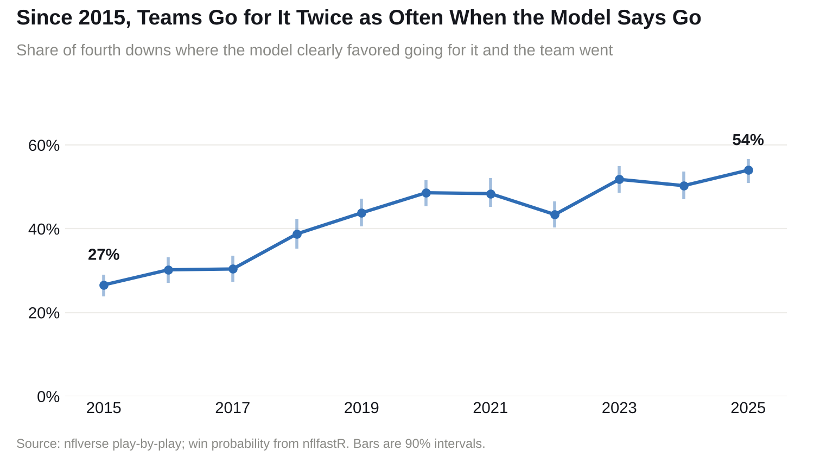
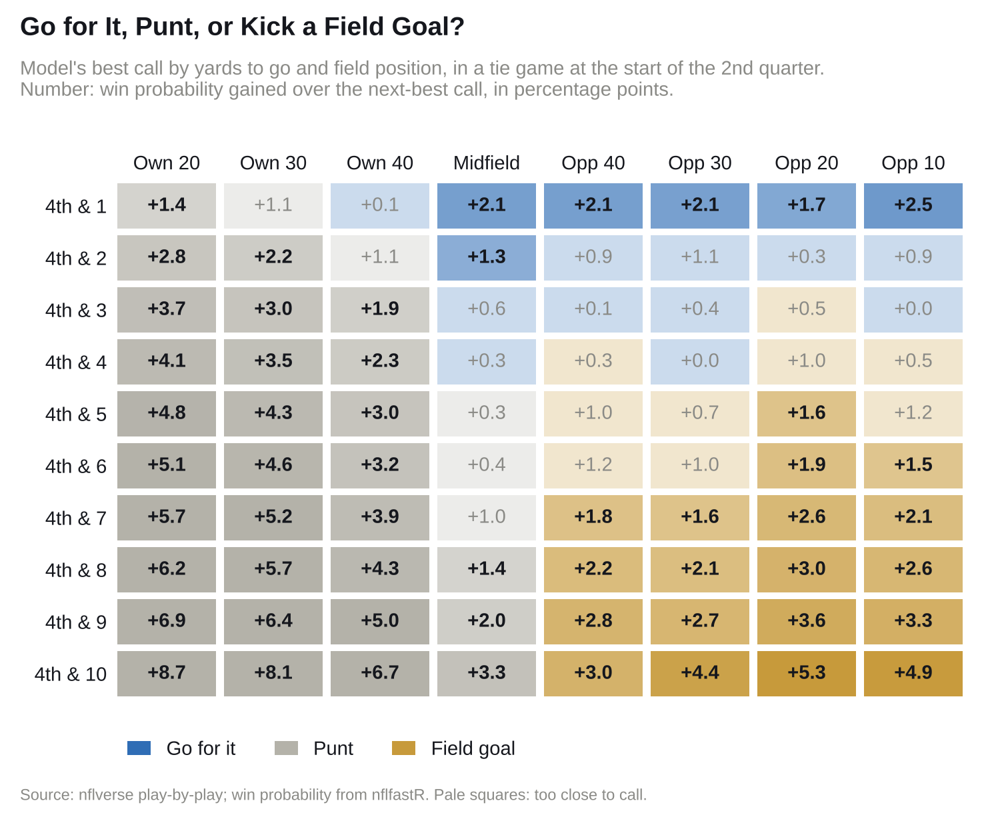

# NFL Fourth-Down Decisions

NFL teams go for it on fourth down far more than they used to: on 12% of fourth downs in
2015 and 23% in 2025, a shift credited to teams adopting analytics
([Sportico](https://www.sportico.com/leagues/football/2024/detroit-lions-dan-campbell-nfl-stats-fourth-down-1234817656/)).
By this project's model, they still don't go for it enough. When the model clearly favored going for
it, teams went for it 27% of the time in 2015 and 54% in 2025.



## Method

```python
wp = WinProbability()  # nflfastR's wp_model_spread, averaged over ±1 minute of clock

go   = p_convert * wp(our_first_down_after_gain) + (1 - p_convert) * wp(their_ball_here)
fg   = p_make * wp(up_3_their_kickoff_return) + (1 - p_make) * wp(their_ball_at_kick_spot)
punt = mean(wp(their_ball_after_each_punt))
```

Conversion, gains, field goals, punts, kickoffs and clock are fit on 2015-2025 plays. Each fourth
down is graded again on 200 resamples of the games. I set the bar for a clear call at
1 percentage point for simplicity: the better option has to win by that much in the middle 90% of
resamples.

## Results



## Fourth-Down Calculator

Example: 4th and 2 at the opponent's 45, down 3, with 2:00 left in the 4th quarter:

```bash
python scripts/call.py --distance 2 --spot "opp 45" --quarter 4 --clock 2:00 --score -3
```

```
go    31.4%
fg    21.8%  (63 yards)
punt  17.1%

Go for it: +9.6 over a field goal (90%: +6.9 to +12.0). Clear call.
```

Optional: `--timeouts`, `--opp-timeouts`, `--spread`, `--home`, `--gets-second-half-kickoff`.

## Limits

- Every team is treated as average except for the point spread.
- nflfastR's model may have been trained on the seasons graded here.
- The intervals don't include error in the win-probability model.

## Run it

```bash
pip install -e ".[dev]"
python scripts/pull.py
python scripts/get_wp_model.py
python scripts/build.py
python scripts/grade.py      # about an hour
python scripts/figures.py
python scripts/readme.py
pytest && ruff check .
```

## Credits

[nflverse](https://github.com/nflverse/nflverse-data) play-by-play (CC BY 4.0). nflfastR's
win-probability model from [fastrmodels](https://cran.r-project.org/package=fastrmodels) (MIT).
Method from [nfl4th](https://github.com/nflverse/nfl4th) and
[Romer (2006)](https://doi.org/10.1086/501171).
