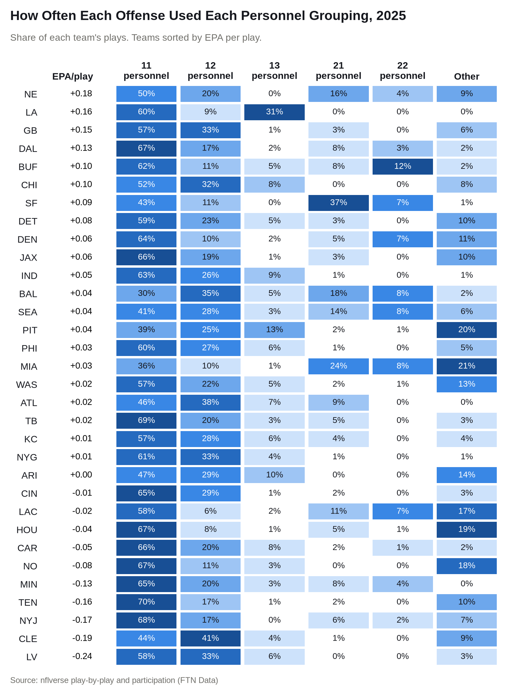
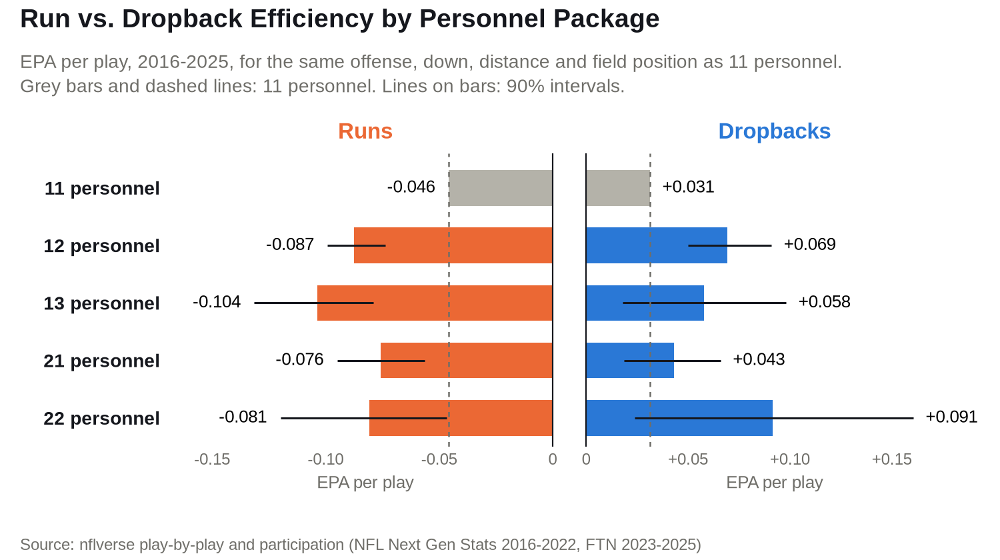
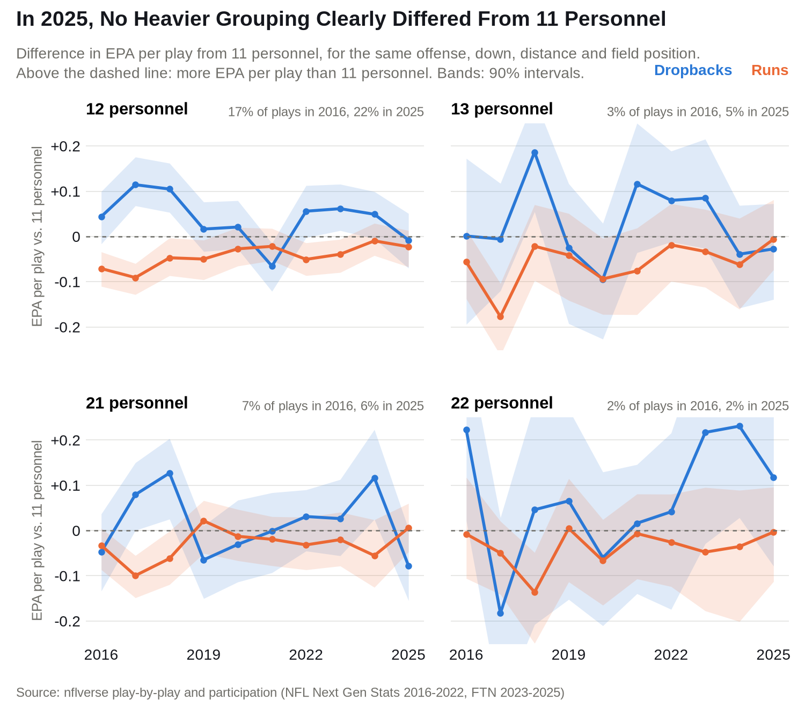

# NFL Personnel Groupings

The NFL seems to be transitioning towards a new era of offense, one that uses heavier personnel packages more
frequently. Where does this shift come from and is it justified?



Notably, the Rams used 13 personnel on 31% of their plays (44% over their last 12 games, after none in their first 5), the most by any team since
2016, and a significant part of their dominant 2025 offense (2nd in EPA per play).

While 11 personnel was still clearly the most used personnel last season, 7 of the top 10 teams in 11 personnel
usage were in the bottom 10 in efficiency.

Note, nearly three quarters of the Other category is groupings with a sixth offensive lineman.

The impacts of all this were felt in the offseason, where 9 TEs were drafted in the first 95 picks
([2026 draft](https://en.wikipedia.org/wiki/2026_NFL_draft)), showing teams' intentions to gain personnel flexibility.

So, is this trend towards heavier personnel packages justified, or are teams overreacting?

## Method

- Every regular-season run and dropback from 2016 to 2025, with personnel data from nflverse. Play-action
  comes from FTN's charting, which starts in 2022.
- Garbage time dropped: plays where either team had over a 90% chance to win.
- Efficiency is expected points added (EPA) per play: how much a play raised or lowered the offense's
  expected points.
- Each grouping is compared to the same team's 11 personnel plays from that season, on similar downs, distances
  and field position. The Rams' 13 personnel plays, for example, are compared to the Rams' own 11 personnel plays.
- To see how much of each difference could be luck, the comparison is rerun on 200 random redraws of the games.
  The middle 90% of those reruns is the 90% interval. A difference is called clear when that whole interval is
  above or below zero.

## Results



In every heavier grouping, offenses were less efficient running and more efficient dropping back than in 11
personnel, though only the dropback gap in 12 personnel is clear. Dropbacks out of 12 personnel gained 0.038
more EPA than dropbacks out of 11 personnel, and runs out of 12 personnel gained 0.042 less.

Most of that running gap goes away once you account for how defenses line up. Against 12 personnel, defenses were
in base on 58% of snaps, compared with 4% against 11 personnel. They also put 6.7 defenders
in the box on average, instead of 6.0. Against the same number of defenders in the box, runs out of 12
personnel trailed runs out of 11 personnel by 0.013 EPA per play, and the gap is no longer clear. For 13,
21 and 22 personnel, it is within 0.015 of zero.

That loaded box is what play-action takes advantage of. From 2022 to 2025, offenses used play-action on 40% of
dropbacks out of 12 personnel and 15% out of 11 personnel. Play-action dropbacks gained more EPA per play than
other dropbacks or runs in every one of those seasons. In 2025, they gained +0.115 EPA per play, compared with
+0.027 for other dropbacks and -0.039 for runs.

So the value of heavier personnel is less about putting a player labeled as a 'TE' on the field instead of one
labeled as a 'WR', and more about what it forces the defense to do. Making a defense respect the run, then throwing
against it, is how offenses are attacking defenses best. That makes personnel flexibility, and marrying the run and
the pass, perhaps more important than living in any one grouping. But as more offenses have leaned on heavier
personnel, have those gaps held up?



For 12 personnel, they have narrowed. Runs out of 12 personnel were clearly less efficient than runs out
of 11 personnel in 6 of 10 seasons, but not in 2025. In 2025, no heavier grouping clearly
differed from 11 personnel, on runs or on dropbacks.

Defenses have also changed how they line up against 12 personnel. They were in base on 74% of its
snaps in 2016, and 48% in 2023, before rising to 58% in 2025. A lighter
box leaves runs less to overcome, and play-action less to exploit.

Defenses have adjusted to 11 personnel too, mostly by finding ways to take away its passing game. EPA per dropback
out of 11 personnel fell from +0.082 in 2020 to -0.017 in 2023, before partly
recovering. This may help explain why other personnel packages, which force the defense to stay sound in the run
game, have found more efficiency in the pass game, even while giving up some in the run game.

So there is no clean answer to whether the shift toward heavier personnel is justified. More than anything, this
shows how NFL schemes on both sides of the ball are constantly evolving, reacting to each other and to the rest of
the league.

## Limits

- Teams choose their personnel, so these gaps describe what happened, not what a grouping causes. The comparison
  accounts for the team and the situation, but not the play call or how the defense lines up.
- Offenses were clearly less efficient in 13 and 22 personnel than in 11 personnel from 2016 to 2020, but
  not from 2021 to 2025.
- Inside the 5-yard line, offenses gained 0.19 more EPA per play in 22 personnel with a sixth lineman
  than in 11 personnel (90% interval: 0.06 to 0.32).

## Run it

```bash
pip install -e ".[dev]"
python scripts/pull.py
python scripts/build.py
python scripts/analyze.py    # will take a long time
python scripts/defense.py
python scripts/figures.py
python scripts/readme.py
pytest && ruff check .
```

## Credits

[nflverse](https://github.com/nflverse/nflverse-data) play-by-play (CC BY 4.0) and participation, from NFL Next
Gen Stats for 2016-2022 and FTN Data for 2023-2025 (CC BY-SA 4.0). The results and charts are CC BY-SA 4.0.
